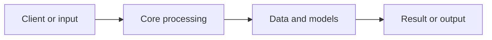

# Architecture and design choices

## Main components

- **1.** API-key gateway
- **2.** Local mock or vLLM backend
- **3.** Redis deterministic cache
- **4.** SSE proxy + P95 metrics
- **5.** No custom GPU scheduler; GPU untested

## Engineering evidence to add

Record reproducible commands and a meaningful baseline; use real licensed data and workload assumptions; compare performance before/after optimization; add full deployment and integration tests; publish failure cases and architectural trade-offs. Never claim benchmarks you have not run.
